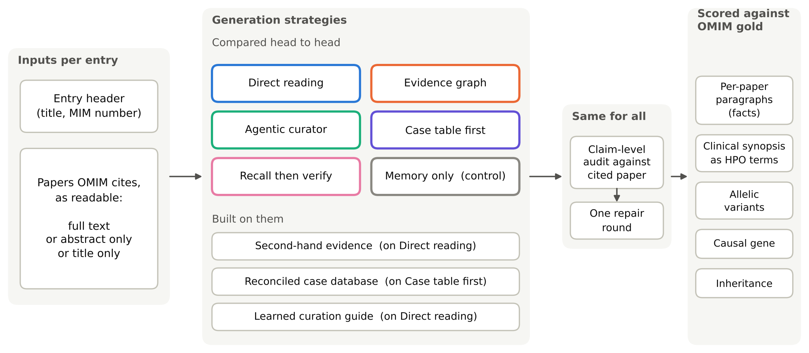
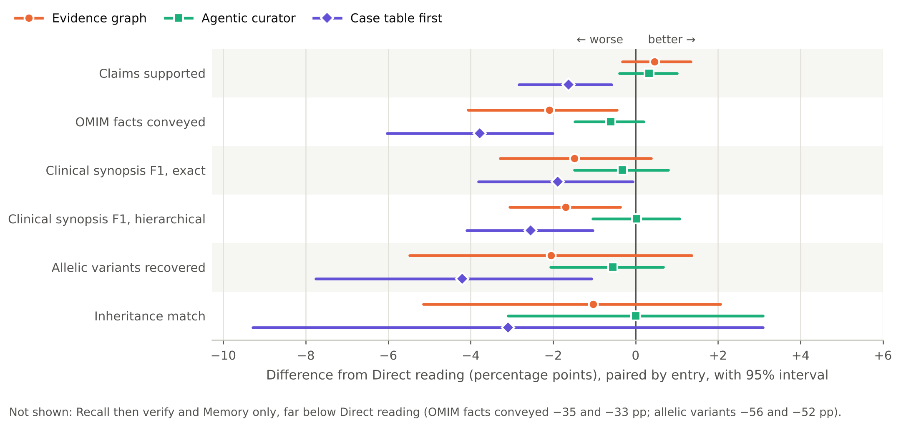
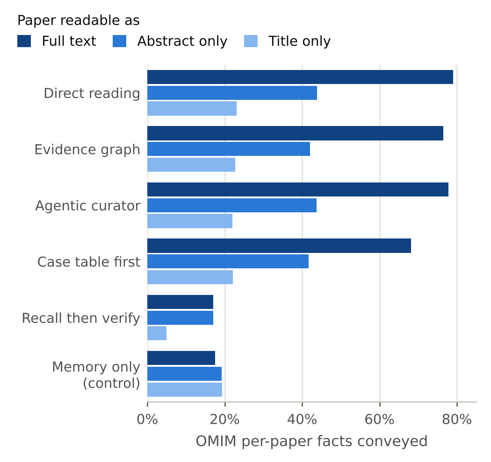
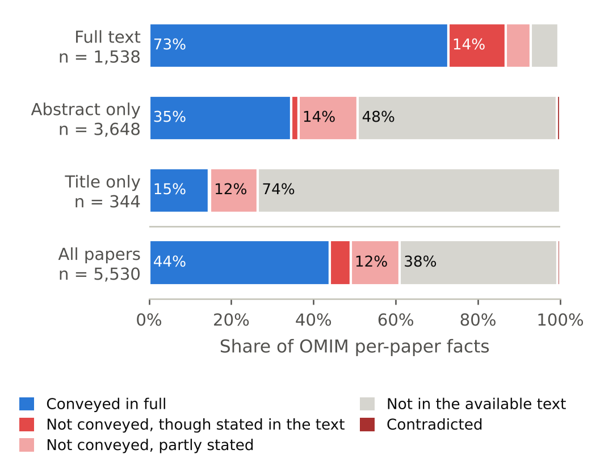
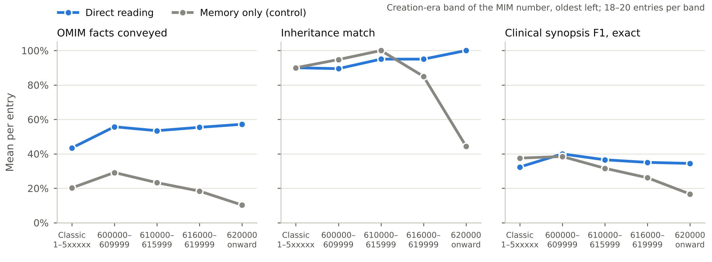
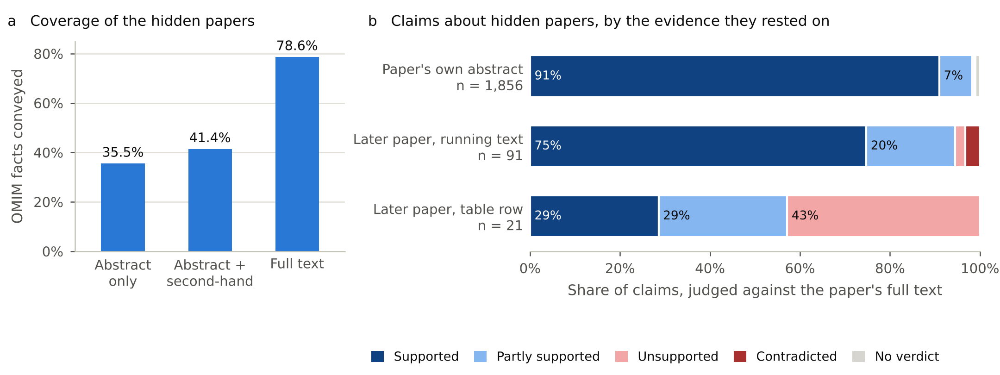
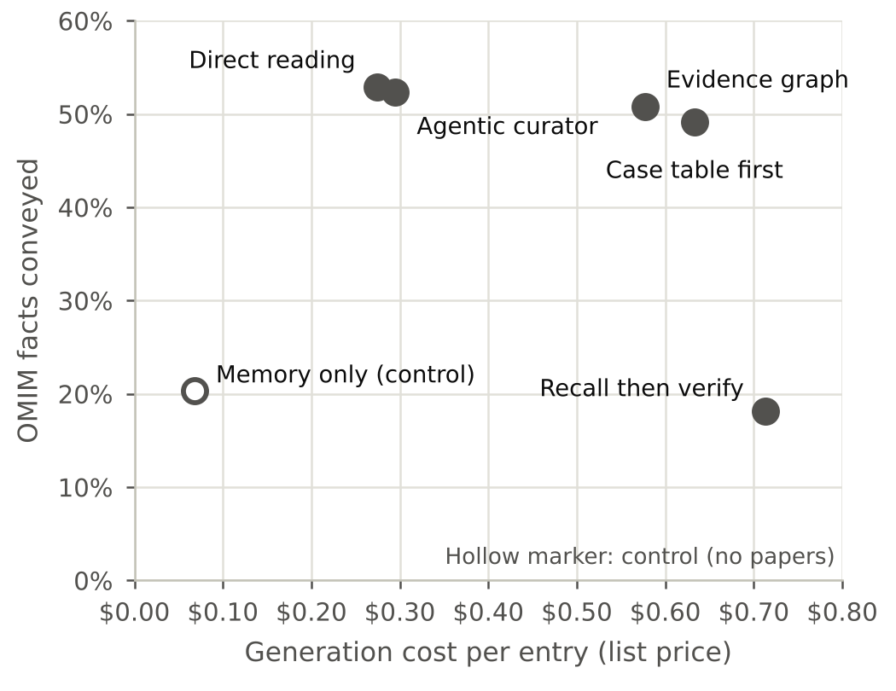

# Drafting OMIM-style disease entries from the literature: a controlled comparison of nine generation strategies

**Draft of 19 November 2026.** Authors and affiliations to be added. Two experiments were still running when this draft
was written; their sections are marked *pending* and hold pilot results only. Every number comes from the result files in
[`results/`](../results); the statements marked as interpretation are ours.

## Abstract

**Background.** OMIM, the reference catalogue of human genes and genetic disorders, is written by hand. Language models
can now read the papers a curator reads, and many ways of turning papers into a structured, cited entry have been
proposed: reading everything at once, extracting into a knowledge graph or a table, agentic reading, writing from memory
and checking afterwards. They have not been compared on the same entries against what curators wrote.

**Methods.** We drew 100 OMIM phenotype entries at random (2–12 references each, 515 papers) and built a gold standard
for each from public OMIM-derived sources. Six generation strategies wrote every entry from the same papers with the
causal gene withheld; three further strategies were built on them. Every draft went through the same claim-level audit
against the cited papers and the same scoring against OMIM: facts conveyed from OMIM's own per-paper paragraphs,
clinical synopsis as HPO terms, allelic variants, causal gene and inheritance.

**Results.** Reading the papers directly, with or without agentic tools, produced the best entries at the lowest cost:
96% of claims fully supported by the cited paper, 53% of OMIM's per-paper facts conveyed, 68% of allelic variants,
99% gene F1 and 94% inheritance agreement. Extracting into an evidence graph or a case table first conveyed 2.1 and 3.8
points fewer facts at twice the cost. Written from memory, 22% of claims were unsupported or contradicted by the
cited papers, and checking a memory draft
against the papers left fewer OMIM facts than any reading strategy. The gap to OMIM was mostly access: 79% of OMIM's
facts were conveyed when the paper was readable in full, 44% from an abstract, and 38% of all OMIM facts were not in
any text we could read. Recovering unreadable papers from later papers that describe them raised variant recall by 5
points but doubled contradictions with OMIM. Reconciling re-reported patients removed 6% of counted individuals and
changed no entry-level score.

**Conclusions.** For entries of this size the choice of generation method matters far less than whether the full text
can be read. Structure is worth its cost when the product is a database, not when it is the entry text.

## 1. Introduction

OMIM (Online Mendelian Inheritance in Man) describes about 7,000 phenotypes with a known molecular basis. Each
entry is a curated narrative with one paragraph per cited paper, a clinical synopsis, a list of allelic variants and a
gene–phenotype table, and it is updated as the literature grows. The work is manual, and the backlog grows with the
literature.

Several lines of work suggest it could be drafted automatically. Retrieval-augmented writers produce cited articles
([STORM](https://arxiv.org/abs/2402.14207), [PaperQA2 and WikiCrow](https://arxiv.org/abs/2409.13740),
[Ai2 Scholar QA](https://arxiv.org/abs/2504.10861)). Structured-extraction systems turn long document sets into tables
or graphs before answering ([SLIDERS](https://arxiv.org/abs/2604.22294), [GraphRAG](https://arxiv.org/abs/2404.16130),
[DocETL](https://arxiv.org/abs/2410.12189)), and [DataSTORM](https://arxiv.org/abs/2604.06474) writes reports from a
database. In genetics, the [Evidence Aggregator](https://www.biorxiv.org/content/10.1101/2025.03.10.642480v1) extracts
per-patient observations for variant curation and [SPIRES](https://academic.oup.com/bioinformatics/article/40/3/btae104/7612230)
fills ontology-grounded schemas. We found no published system that generates OMIM-, Orphanet- or MONDO-style disease
entries and scores them against curators; our survey of seventeen approaches is in
[`approach-survey.md`](approach-survey.md).

These systems differ along a few axes: what intermediate representation is built (none, a graph, a table), who decides
what to read (the pipeline or the model), where the content comes from (the papers or the model's memory), and whether
anything is learned from examples. We turned each axis into a strategy inside one pipeline, so that the same model
writes from the same papers and everything downstream is identical, and asked three questions:

1. How close does each strategy come to the entry OMIM's curators wrote, and how faithful is it to the papers it cites?
2. What limits the result: the method, or what the method is given to read?
3. What do structure, memory, second-hand evidence and supervision each add, and at what cost?

## 2. Methods

### 2.1 Gold standard

OMIM's website forbids automated access and its full text needs a licence, so the gold standard was assembled from
public sources that carry OMIM's own content:

- **References:** the papers each entry cites, from NCBI's OMIM-to-PubMed links.
- **Per-paper paragraphs:** OMIM's allelic-variant descriptions as submitted by OMIM to ClinVar. Each is OMIM-authored
  prose about one or more cited papers. We call a paragraph *in scope* when it concerns the entry's own phenotype.
- **Clinical synopsis:** the entry's HPO annotations from the HPO annotation file, which are derived from OMIM.
- **Causal gene and inheritance:** OMIM's gene map through MedGen and `mim2gene`, and the HPO inheritance annotations.
- **Allelic variants:** the entry's OMIM-submitted ClinVar records.

OMIM-authored wording is used for scoring only and is not redistributed in the repository.

### 2.2 Evaluation set

One hundred phenotype entries were drawn at random with a fixed seed, 20 from each of five bands of MIM number that
track when an entry was created (1xxxxx–5xxxxx, 600000–609999, 610000–615999, 616000–619999, 620000 onward). Entries
needed 2–12 cited references, a causal gene, at least five HPO annotations and at least one in-scope paragraph. The set
has 515 papers, 476 scored OMIM paragraphs, 427 in-scope allelic variants and 2,542 HPO annotations.

**Access to the papers** was whatever is openly available: 96 papers (19%) were readable in full through PubMed Central
or Europe PMC, 345 as an abstract only and 74 as a title only. Supplementary material was not retrieved.

Each strategy was given the entry's header (number, title, alternative titles) and exactly the papers OMIM cites. The
causal gene was withheld, so that naming it is part of the task.

### 2.3 Generation strategies

All strategies return the same entry structure: an introductory paragraph, sections of paragraphs each citing papers, a
gene–phenotype table with inheritance, a clinical synopsis and a list of allelic variants.

*Figure 1. Study design. Every strategy receives the same header and papers, and every draft goes through the same
audit and the same scoring.*

**Six strategies compared head to head**

| Strategy | Intermediate representation | What it does |
|---|---|---|
| Direct reading | None | All papers in one prompt; the model writes the entry. |
| Evidence graph | Knowledge graph | Quote-backed findings are extracted per paper and discarded if the quote is not in the paper; findings are joined into a graph of papers, genes, variants, phenotypes and inheritance; the entry is written from the graph. |
| Agentic curator | None | The model works in a folder holding the papers with tools to read and search them, decides what to read and re-check, and must give a verbatim quote for every paragraph. |
| Case table first | Table of cases | One record is extracted per reported patient or family; records are pooled; synopsis frequencies, candidate genes and inheritance are computed by rule; the entry is rendered from the table. |
| Recall, then verify | Memory draft | The model writes from memory; the draft is audited against the papers; the entry is rewritten from what the audit supports. |
| Memory only (control) | None | The model writes from memory with no papers. It shows what the model already knows; nothing in it is grounded. |

**Three strategies built on them**

| Strategy | Built on | What it adds |
|---|---|---|
| Second-hand evidence | Direct reading | For a paper not readable in full, passages from later open-access papers that cite and describe it are found through Europe PMC and given to the writer and the audit, marked as second-hand. |
| Reconciled case database | Case table | A propose–verify–apply step merges the same patient, family or variant reported in several papers and settles conflicts, before anything is computed. |
| Learned curation guide | Direct reading | A short guide to what OMIM reports and which synopsis terms it lists is learned from 30 training entries' omissions and extras, then applied to 70 held-out entries. |

Second-hand evidence is inspired by citation following in PaperQA2, reconciliation by SLIDERS, and the guide by
reflective prompt optimisation ([GEPA](https://arxiv.org/abs/2507.19457)) at a budget of two rounds.

**Guards shared by all strategies.** HPO identifiers are never written by the model: phrases are matched to the
ontology and the model chooses among candidates. Gene symbols are normalised against HGNC. OMIM cross-reference numbers
recalled from memory are stripped. A paragraph must cite a supplied paper.

### 2.4 Audit and repair

Every draft goes through the same audit. Paragraphs are split into atomic claims, each attributed to the papers it
cites; each paper is then given the claims attributed to it and returns a verdict per claim (supported, partly
supported, unsupported, contradicted) with a quote, and the quote is checked to occur in the paper. A claim's verdict
is the best across the papers it cites. Flagged claims go through one repair round in which the writer revises or
deletes them, and are audited again. The memory-only control is audited but not repaired.

### 2.5 Scoring against OMIM

- **Faithfulness:** share of claims supported by the cited paper, and share unsupported or contradicted before and
  after repair.
- **OMIM facts conveyed:** each in-scope OMIM paragraph is split by a judge into atomic facts, and each fact is marked
  present, partly present, absent or contradicted in what the draft says about that paper. Coverage counts a partial
  fact as half.
- **Clinical synopsis:** precision, recall and F1 of the draft's HPO terms against OMIM's annotations, exact,
  hierarchical (ancestors count) and semantic.
- **Allelic variants:** recall of OMIM's in-scope variants, matched on normalised protein or nucleotide change, with a
  judge for names that do not normalise.
- **Causal gene** F1 and **inheritance** agreement.

Strategies are compared entry by entry against direct reading, with a bootstrap 95% interval over entries (10,000
resamples).

### 2.6 Further analyses

- **Where missed facts went.** Every OMIM fact that direct reading did not fully convey was checked against the text
  available for that paper: stated, partly stated, or not there.
- **Is the audit reliable?** One fact was altered in each of 60 paragraphs the audit had passed.
- **Who is right when a draft contradicts OMIM?** Each such fact was taken back to the paper.
- **Is second-hand evidence accurate?** For papers we could read in full, the full text was hidden, entries were
  written from the abstract with and without second-hand passages, and the resulting claims were audited against the
  real full text.
- **Updates and open retrieval.** Ten entries were rolled back to an earlier reference list to test update discovery;
  ten were written from a literature search with no reference list.

### 2.7 Model, cost and stopped replies

All generation, auditing and judging used Claude Opus 5.5 through the Claude Code command-line interface in headless
mode, with schema-constrained output and no tools except in the agentic strategy (read and search only). Replies are
cached, so every strategy's calls are made once. Cost is reported as tokens and as list price per entry, split into
generation, audit and scoring.

For a few entries the model's safety filter stopped a reply, and the interface returned an empty result. We record
this as "no draft", do not retry with altered prompts, and compare strategies only on entries where every strategy
produced a draft, listing the rest.

## 3. Results

### 3.1 Six strategies on the same entries

Ninety-seven entries were compared. Three were left out because a writer's reply was stopped: direct reading on three
entries, the agentic curator on two and the evidence graph on one.

**Table 1. Six strategies, 97 entries.** Means over entries.

| | Direct reading | Agentic curator | Evidence graph | Case table first | Recall, then verify | Memory only (control) |
|---|---|---|---|---|---|---|
| Claims audited (total) | 10,038 | 9,705 | 11,218 | 11,388 | 2,581 | 2,753 |
| Claims supported by the cited paper | 96.1% | 96.5% | 96.6% | 94.5% | 94.3% | 51.5% |
| Unsupported or contradicted, before repair | 0.4% | 0.2% | 0.3% | 0.8% | 0.6% | 22.3% |
| … after repair (claims) | 0 | 1 | 0 | 1 | 0 | not repaired |
| OMIM facts conveyed | 52.9% | 52.3% | 50.8% | 49.1% | 18.1% | 20.4% |
| OMIM facts contradicted | 0.5% | 0.6% | 0.7% | 0.6% | 0.5% | 0.8% |
| Clinical synopsis F1: exact / hierarchical / semantic | 35.6 / 56.3 / 66.3 | 35.3 / 56.3 / 66.0 | 34.2 / 54.6 / 64.9 | 33.9 / 53.8 / 64.5 | 26.1 / 42.7 / 56.6 | 30.4 / 48.1 / 62.3 |
| … exact precision / recall | 43.6 / 35.9 | 44.9 / 33.9 | 40.0 / 37.0 | 40.4 / 37.3 | 53.3 / 18.0 | 53.1 / 23.6 |
| OMIM allelic variants recovered | 67.6% | 67.1% | 65.6% | 63.4% | 11.7% | 15.6% |
| Causal gene F1 | 98.6% | 98.6% | 99.3% | 96.1% | 97.6% | 97.6% |
| Inheritance matches OMIM | 93.8% | 93.8% | 92.8% | 90.7% | 74.2% | 83.5% |
| Synopsis terms per entry | 15.6 | 14.1 | 19.7 | 21.4 | 4.4 | 6.1 |

**Table 2. Paired differences from direct reading**, percentage points with 95% intervals.

| | Agentic curator | Evidence graph | Case table first |
|---|---|---|---|
| Claims supported | +0.3 (−0.4 to +1.0) | +0.5 (−0.3 to +1.3) | −1.6 (−2.8 to −0.6) |
| OMIM facts conveyed | −0.6 (−1.5 to +0.2) | −2.1 (−4.1 to −0.4) | −3.8 (−6.0 to −2.0) |
| Synopsis F1, exact | −0.3 (−1.5 to +0.8) | −1.5 (−3.3 to +0.4) | −1.9 (−3.8 to −0.1) |
| Synopsis F1, hierarchical | 0.0 (−1.0 to +1.1) | −1.7 (−3.0 to −0.4) | −2.5 (−4.1 to −1.0) |
| Allelic variants recovered | −0.5 (−2.1 to +0.7) | −2.1 (−5.5 to +1.4) | −4.2 (−7.8 to −1.1) |
| Inheritance match | 0.0 (−3.1 to +3.1) | −1.0 (−5.1 to +2.1) | −3.1 (−9.3 to +3.1) |

*Figure 2. Paired differences from direct reading with 95% intervals, 97 entries.*

- **The three strategies that read the papers are faithful.** About 96% of their claims were fully supported and the
  rest partly; after one repair round at most one unsupported claim remained in roughly 10,000. Every one of the 1,833
  findings in the evidence graphs and all 2,600 quotes offered by the agent were found verbatim in the papers.
- **Direct reading and the agentic curator are indistinguishable.** The agent opened every paper in all 98 entries it
  wrote and cost about the same.
- **Structure first costs content.** The evidence graph conveyed 2.1 points fewer OMIM facts than direct reading and
  the case table 3.8 fewer; the case table also recovered fewer variants and had fewer fully supported claims. Both
  list more synopsis terms at lower precision.
- **Memory is not a source.** Written from memory, 22% of claims were unsupported or contradicted by the papers and
  only 16% of OMIM's variants appeared. The model nearly always knew the gene (97.6% F1).
- **Checking a memory draft does not rescue it.** Recall-then-verify was as faithful as the reading strategies but
  conveyed fewer OMIM facts than the unchecked memory draft, because verification can only delete: of 2,794 memory
  claims, 52% were supported by the papers. It was also the most expensive strategy to generate.

### 3.2 Access to the paper decides how much of OMIM is conveyed

**Table 3. OMIM facts conveyed, by how the paper was readable.**

| Paper readable as | Direct reading | Agentic curator | Evidence graph | Case table first | Memory only |
|---|---|---|---|---|---|
| Full text | 79.1% | 77.9% | 76.5% | 68.2% | 17.5% |
| Abstract only | 43.9% | 43.7% | 42.0% | 41.7% | 19.2% |
| Title only | 23.1% | 22.0% | 22.7% | 22.1% | 19.3% |

*Figure 3. OMIM facts conveyed, by how the cited paper was readable. A partly conveyed fact counts as half.*

The difference between a full text and an abstract (35 points) is about nine times the largest overall difference
between reading strategies (3.8 points). Variant recovery follows the same line: for direct reading, 48% in entries with no full-text paper and 89%
where at least half the papers were readable in full.

The gap analysis makes the same point fact by fact (direct reading, 97 entries, 5,530 OMIM facts):

**Table 4. What happened to OMIM's facts.**

| Paper readable as | OMIM facts | Conveyed | Stated in our text, omitted | Partly stated | Not in our text |
|---|---|---|---|---|---|
| Full text | 1,538 | 1,119 | 216 | 92 | 104 |
| Abstract only | 3,648 | 1,260 | 65 | 527 | 1,767 |
| Title only | 344 | 50 | 1 | 40 | 253 |
| All | 5,530 | 2,429 (44%) | 282 (5%) | 659 (12%) | 2,124 (38%) |

*Figure 4. What happened to OMIM's facts under direct reading. Here "conveyed" means fully conveyed; facts conveyed in
part are counted with those that were not, which is why the shares are lower than in Table 3.*

In Table 4 a fact counts as conveyed only when it is fully present, and a partly conveyed fact is assigned to whichever
of the other columns describes the text. Thirty-eight percent of OMIM's facts were not in any text the writer was given, and only 5% were plainly there and left
out. Even for full-text papers, 104 facts were not in the main text; supplementary tables are the likely source of
many. A better writer could recover at most the 5–17% that was stated or partly stated.

### 3.3 What the model already knows, and whether that inflates the results

OMIM is public and the model has seen it. The memory-only control measures how much that could contribute.

**Table 5. Memory only against direct reading, by when the entry was created.**

| MIM range | Entries | Facts conveyed: memory / direct | Inheritance match: memory / direct | Synopsis exact F1: memory / direct |
|---|---|---|---|---|
| 1xxxxx–5xxxxx | 20 | 20.2% / 43.4% | 90% / 90% | 37.5% / 32.4% |
| 600000–609999 | 19 | 29.1% / 55.7% | 95% / 90% | 38.4% / 40.0% |
| 610000–615999 | 20 | 23.2% / 53.4% | 100% / 95% | 31.6% / 36.5% |
| 616000–619999 | 20 | 18.4% / 55.4% | 85% / 95% | 26.1% / 35.0% |
| 620000 onward | 18 | 10.3% / 57.2% | 44% / 100% | 16.6% / 34.4% |

*Figure 5. Memory only against direct reading, by when the entry was created.*

- For the newest entries memory supplies almost nothing, while direct reading does as well there as anywhere (57%).
  The reading results therefore do not depend on memorised OMIM text.
- For the oldest entries, memory alone scores higher on the clinical synopsis than reading does (37.5% against
  30–33%), with a third as many terms. The synopsis score measures which terms are chosen more than what is read: OMIM's
  synopsis draws on more than the cited papers, and the reading strategies list many supportable terms OMIM does not.

### 3.4 Second-hand evidence for papers that cannot be read

Open-access papers that cite and describe the target were found for 473 of the 515 papers (326 of 345 abstract-only,
53 of 74 title-only): 2,430 passages.

**Accuracy, with the full text hidden** (49 entries, 91 papers). Coverage is over the 46 entries that have a
full-text draft to compare with (136 OMIM paragraphs); the claim counts use all 49.

| What the writer had | OMIM facts conveyed |
|---|---|
| Abstract only | 35.5% |
| Abstract plus second-hand passages | 41.4% |
| The real full text | 78.6% |

| The claim rested on | Claims | Supported by the full text | Partly | Unsupported | Contradicted |
|---|---|---|---|---|---|
| The paper's own abstract | 1,856 | 1,688 (91%) | 136 | 8 | 6 |
| A later paper's running text | 91 | 68 (75%) | 18 | 2 | 3 |
| A row in a later paper's table | 21 | 6 (29%) | 6 | 9 | 0 |

*Figure 6. The hidden-full-text experiment. (a) OMIM facts conveyed about the hidden papers. (b) Verdicts against the
paper's full text, by the evidence a claim rested on.*

Second-hand passages closed about 6 points of a 43-point gap. Claims taken from a later paper's running text were
unsupported or contradicted in 5% of cases, against under 1% for claims from the abstract; rows from review tables
were unsupported in 9 of 21. Our full texts exclude supplements, so "unsupported" is an upper bound. The ordinary audit
does not catch these errors, because it checks the claim against the same second-hand text the writer saw.

**In use, on all 100 entries** (96 compared), with second-hand-only claims marked and not counted as supported:

| | Direct reading | With second-hand evidence | Difference (95% interval) |
|---|---|---|---|
| OMIM facts conveyed | 53.2% | 54.0% | +0.8 (−0.3 to +1.9) |
| … title-only papers | 23.1% | 30.1% | |
| OMIM allelic variants recovered | 68.2% | 73.2% | +5.0 (+1.3 to +9.2) |
| Synopsis F1, hierarchical | 56.7% | 58.9% | +2.2 (+0.4 to +4.3) |
| OMIM facts contradicted | 0.5% | 1.0% | +0.4 (+0.1 to +0.9) |
| Claims unsupported before repair | 0.4% | 3.9% | +3.6 (+2.2 to +5.1) |

Only 240 of 10,597 claims (2.3%) ended up resting on second-hand text. The gains are concentrated in variants and in
old papers with no abstract; contradictions with OMIM doubled.

### 3.5 Reconciling the case table

On all 100 entries, reconciliation accepted 40 merges of re-reported patients or families (57 proposed, 17 rejected by
the verifier) in 26 entries, merged 10 variant names and found 56 conflicts between papers. Counted individuals fell
from 2,580 to 2,414: about 6% had been counted twice. In a planted test on six entries, 10 of 10 copied reports were
merged with their originals and no unrelated records were merged.

No entry-level score changed by more than 0.1 point, and agreement with the patient-count fractions in OMIM's HPO
annotations was unchanged (560 terms; fractions agree for 48%, mean absolute difference 0.26). Reconciliation costs
one or two calls per entry. The pooled result is a database of 739 patient or family records, 529 variants and about
2,350 phenotype rows across the 100 entries.

### 3.6 A learned curation guide — *pending*

The first guide was learned from feedback that included three empty drafts, so it is being relearned; the held-out
test on 70 entries has not been run. On an 8-entry pilot the first guide improved the clinical synopsis (exact F1 28.7%
to 32.9%, interval +1.2 to +7.3; hierarchical F1 better on 7 of 8 entries) and did not improve OMIM facts conveyed
(48.2% to 45.1%, interval −7.0 to +0.5). That pattern is what section 3.2 predicts: little of the fact gap is editorial
choice, while the synopsis is a problem of term selection. *To be replaced with the held-out result.*

### 3.7 Large entries — *pending*

Twelve entries with 30–100 references (536 papers; 29 readable in full) are being run with five strategies. In two
pilot entries (44 and 73 papers) every strategy ran end to end; direct reading needed batching for one entry, where
the papers exceeded a single prompt. Stopped replies were more frequent than on small entries: the evidence-graph
writer was stopped twice on one entry, and some audit calls on two papers were stopped for every strategy. Cost was
$5–14 per entry per strategy. *To be replaced with the 12-entry result.*

### 3.8 Is the audit reliable, and who is right when a draft disagrees with OMIM?

- **Planted errors.** In 60 paragraphs the audit had passed, one fact was altered (a count, a zygosity, a residue, a
  mode of inheritance). The audit flagged all 60, each on the altered fact.
- **Disagreements with OMIM.** In an earlier run of the evidence graph, 43 facts in its drafts contradicted OMIM's
  paragraph. Taken back to the paper, the paper supported the draft in 29, OMIM in 1 and both in 5; 8 could not be
  decided from the readable text. Typical cases are transposed digits or a changed residue in a variant name. These
  compare against the copy of OMIM's text in ClinVar and are leads for a curator, not established errors.

### 3.9 Updates and retrieval without a reference list

- **Updates.** Ten entries were rolled back to their earlier references. A literature search found all 28 references
  OMIM later added; 21 (75%) passed screening and became update proposals. Of 165 drafted paragraphs the audit flagged
  2. The same run proposed 33 papers OMIM does not cite.
- **Open retrieval.** Given only a title and the causal gene, the pipeline selected 56 of the 85 references OMIM cites
  for ten entries (66%); 47% of what it selected is in OMIM's list. Entries written from that literature were as
  faithful as the rest (97% of claims supported).

### 3.10 Cost

**Table 6. Cost per entry**, at list price.

| | Direct reading | Agentic curator | Evidence graph | Case table first | Recall, then verify | Memory only |
|---|---|---|---|---|---|---|
| Generation: model calls | 1.8 | 1.8 | 7.0 | 7.0 | 9.2 | 1.6 |
| Generation: input / output tokens | 21,800 / 6,300 | 61,200 / 9,000 | 56,800 / 15,600 | 65,800 / 17,500 | 57,800 / 18,500 | 6,200 / 2,300 |
| Generation | $0.27 | $0.29 | $0.58 | $0.63 | $0.71 | $0.07 |
| Audit and repair | $0.75 | $0.71 | $0.79 | $0.79 | $0.31 | $0.51 |
| Scoring against OMIM | $0.20 | $0.19 | $0.20 | $0.20 | $0.13 | $0.15 |
| Total | $1.23 | $1.20 | $1.56 | $1.62 | $1.16 | $0.73 |

*Figure 7. Generation cost per entry at list price against OMIM facts conveyed.*

For the strategies that read the papers, the audit costs more than generation. The agent's input tokens are mostly cached re-reads, which is
why it costs as little as direct reading. Scoring is needed only for evaluation.

## 4. Discussion

### 4.1 What matters

**What the writer can read matters most.** Full text against abstract is worth 35 points of OMIM's facts; the best
against the worst reading strategy is worth 4. Over a third of OMIM's facts were in no text we could obtain. For a
project that wants to reproduce OMIM, licensed full text and supplementary tables would do more than any change of
method tested here.

**At this entry size, the simplest method is the best.** With 2–12 papers everything fits in one prompt, and a model
that reads it all writes an entry that is as faithful as, and slightly more complete than, one written from an
extracted graph or table, at half the generation cost. Extraction loses detail; it does not add accuracy.

**Structure pays when the database is the product.** The case table and its reconciliation produce what an entry
cannot: per-patient records, variant lists with sources, phenotype counts, and a correction for patients reported
twice. None of that shows in entry-level scores, which is itself a finding: the measures suited to judging an entry do
not value the database.

**The model's memory is a hazard, not a shortcut.** It knows the gene and the outline of older disorders, and it
produces plausible, wrong detail. Verification afterwards removes the errors and most of the content.

**The audit is the component that makes the rest usable.** It caught every planted error, it brought unsupported
claims to near zero, and where draft and OMIM disagreed the paper usually sided with the draft. It is also the largest
cost. Its blind spot is evidence that is not the cited paper's own text.

### 4.2 Strengths and weaknesses of each approach

| Approach | Strengths | Weaknesses | Use it for |
|---|---|---|---|
| Direct reading | Best or equal on every score; cheapest; simplest | Needs everything in one prompt; no reusable structure; a stopped reply loses the whole entry | Entries whose papers fit in context |
| Agentic curator | Equal to direct reading; quotes for every paragraph; does not need papers in one prompt | Cost and behaviour less predictable; more stopped replies in our run | Larger entries; when per-paragraph quotes are wanted |
| Evidence graph | Every paragraph traceable to findings and quotes; computed gene, inheritance and variant tables | 2 points fewer facts; lower synopsis precision; twice the cost | Provenance-first curation; queries across entries |
| Case table | Per-patient database with counts | Weakest reading strategy on facts, variants and faithfulness | Building the database, not writing the entry |
| Reconciled case database | Removes double counting; logs conflicts between papers; cheap | No effect on entry scores at this size | Any use of patient counts |
| Recall, then verify | Faithful | Conveys least; most expensive to generate | Not recommended |
| Memory only | Cheapest; shows what is already known | 22% of claims unsupported or contradicted; useless for recent disorders | A control only |
| Second-hand evidence | Recovers variants and old papers with no abstract | Errors the audit cannot see; doubles contradictions | Flagged leads for a curator |
| Learned curation guide | Improves synopsis term choice (pilot) | No gain in facts conveyed (pilot); needs clean training data | Synopsis; *pending held-out test* |

### 4.3 Towards an OMIM-like database

The results suggest a combination, not a single winner (interpretation):

1. Write the narrative by direct reading, or with the agent when the papers do not fit in one prompt.
2. Build the structured side from the reconciled case table, with every value tied to a quote.
3. Audit everything against the cited papers and show the verdicts to the curator.
4. Offer second-hand passages and candidate corrections as marked leads, never as entry text.
5. Spend effort on access before method.

### 4.4 Limitations

- **One model.** All writing, auditing and judging used one model. A judge from the same family may share the writer's
  blind spots; the planted-error test addresses this only for the audit.
- **The gold standard is indirect.** OMIM's per-paper paragraphs here are its allelic-variant descriptions as held in
  ClinVar, not the whole entry, and the clinical synopsis is OMIM as rendered in HPO annotations. A fact that OMIM
  states in another section is not credited.
- **Fact splitting is not frozen.** The judge splits each OMIM paragraph into facts separately for each draft, so fact
  counts differ slightly between strategies and facts cannot be aligned one to one.
- **Entry size.** The main comparison covers 2–12 references. Across OMIM, about one entry in six has more, and those
  hold most of the references; section 3.7 will address this.
- **Oracle retrieval.** Strategies were given OMIM's reference list. Finding the literature is tested only on ten
  entries.
- **One run per entry.** Run-to-run variation was not measured.
- **Stopped replies.** A safety filter stopped some replies, for reasons we cannot see; three of 100 entries are
  excluded from the main comparison, and stops were more frequent on large entries.
- **Supplementary material** was not retrieved, which understates what a full-text reader could convey and overstates
  the error of second-hand claims.
- **Cost** is at list price for one model and will not transfer directly to others.

## 5. Conclusion

Nine ways of drafting OMIM-style entries were run on the same entries and scored against what curators wrote. Reading
the papers directly was the most complete and the cheapest, intermediate structure cost a few points of content, the
model's memory was unreliable, and no method recovered what could not be read. The practical route to an automated,
curator-reviewed OMIM-like resource is direct reading for the text, a reconciled case table for the database, a
claim-level audit over both, and access to the full papers.

## Data and code availability

Code, evaluation sets, generated entries, audits and scores are in this repository. `results/omim100/` holds the
six-strategy run, `results/omim100_secondhand/` and `results/omim100_reconciled/` the derived strategies, and
[`approach-survey.md`](approach-survey.md) the survey of published approaches with token estimates. OMIM-authored text
is not included. The run can be browsed with `AIOMIM_RUNS=results aiomim report omim100`.

## Open items before submission

- Sections 3.6 and 3.7: replace pilot results with the held-out guide test and the 12-entry large tier.
- Confirm the candidate corrections against live OMIM entries with a curator.
- Decide whether to add a second model as writer or judge.
- Author list, acknowledgements, and a statement on OMIM data use.
